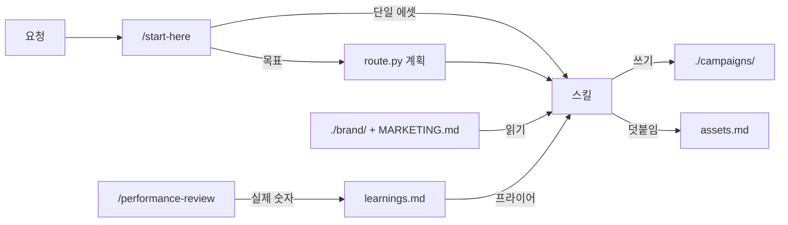

# 시스템 가이드: 한국 마케팅 스킬이 동작하는 방식

설치 다음에 읽는 한 페이지예요. 요청을 치면 무슨 일이 일어나는지, 파일이 어디에 있는지, 쓸수록 어떻게 날카로워지는지를 설명해요. 라이브러리는 어떤 사업에도 동작해요 (소프트웨어, 쇼핑몰, 크리에이터, 대행사). 지역 사업 팩은 설비, 지붕, 치과와 그들을 돕는 대행사를 깊게 다뤄요. 시작만 하려면 설치하고 `/start-here`에 사업 이름을 말하세요.

이 팩의 저자는 제임스 (@beaulead-james)예요. 원작 귀속은 README에 있어요. 스킬은 원작을 판매하지 않고, 이 팩도 유료 제안으로 보내지 않아요.

## 설치

| 경로 | 명령 | 스킬이 놓이는 곳 |
|---|---|---|
| 아무 에이전트 (Claude Code, Codex, Cursor 등) | `npx skills add beaulead-james/korean-marketing-skills` | 프로젝트의 `.agents/skills/<name>/`. Claude Code용으로 `.claude/skills/<name>`이 그 폴더를 가리켜요. 모든 프로젝트면 `-g`. |
| Claude Code 플러그인 | `/plugin marketplace add beaulead-james/korean-marketing-skills` 다음 `/plugin install korean-marketing@korean-marketing-skills` | 플러그인 캐시. 스킬에는 접두사가 붙어요. `/korean-marketing:start-here`. 훅 (클라이언트 격리, 에셋 등록)은 자동으로 불러와요. |
| 설치 스크립트 | 클론에서 `_system/scripts/install.sh` | `~/.claude/skills/`와 `~/.claude/_system/` |

어느 경로든 같은 스킬이에요. 이 가이드는 짧은 형태 (`/start-here`)를 써요. 공유 런타임 (`brand_context.py`, `capability.py`, `route.py`)은 `start-here/scripts/` 안에 있어서 어느 경로든 브랜드 파일을 불러요. 스킬은 `<스킬 폴더>/../start-here/scripts/...`로 호출해요. python3가 없으면 스킬이 브랜드 폴더를 직접 읽어요.

## 1분에 보는 동작

1. `/start-here`에 사업 이름 (또는 URL)을 말해요. **라이트 읽기**는 약 3분이에요. 사이트와 고객이 한 말 (지역 사업은 네이버 플레이스 리뷰, 소프트웨어와 쇼핑몰은 공개 리뷰)을 읽고, 누가 먼저 보이는지 찾고, 핵심 브랜드 파일을 `./brand/`에 쓰고, 첫 행동 하나를 말해요. **deep**이라고 하면 전체 파운데이션이에요. 리서치 에이전트 넷이 병렬로, 약 15분.
2. 그다음부터 `/start-here`에 평범한 말로 해요. "다음에 뭘 하죠", "사이트 봐 주세요", "플레이스 리뷰를 늘리고 싶어요", "새 클라이언트 hanbit.example", "클라이언트를 찾고 싶어요". 맞는 스킬이나 스킬 체인으로 보내고, 이유를 한 줄로 말해요.
3. 모든 스킬은 필요한 브랜드 파일만 읽고, 산출물을 `./campaigns/<name>/` (또는 자기 브랜드 파일)에 쓰고, 에셋을 등록하고, 다음 단계 2개에서 4개로 끝내요.
4. `/performance-review`가 실제 숫자를 learnings로 만들고, 다른 모든 스킬이 다음에 적용해요.
5. 사용자 없이 게시, 발송, 지출은 없어요. 항상 초안과 파일이에요.

API 키는 필요 없어요. 모든 스킬은 에이전트 자신의 웹 검색·가져오기와 사용자가 준 파일로 동작해요. 키와 도구는 리서치를 깊게 하고 행동을 열어요. 아래 도구와 `TOOLS.md`를 보세요.

## 파일

모든 것은 스킬 설치가 아니라 프로젝트 폴더에 있어요. 업데이트가 그 폴더를 건드리지 않아요.

### `./brand/`: 브랜드 메모리

| 파일 | 쓰는 스킬 | 담는 것 |
|---|---|---|
| `brand.yaml` | `/start-here`, 그다음 프로필을 고치는 스킬 | 매니페스트. 이름, URL, 사업 사실 (업종, 서비스. 지역 사업은 전화, 시·구, 상권, 본 날짜의 평점), 있는 파일, 각 변경 시각, 활성 캠페인. 모든 스킬이 사업 사실을 봐요. |
| `voice-profile.md` | `/start-here` (lite), `/brand-voice` | 말투. 톤, 문장 길이, 어휘, 플랫폼별 적응 |
| `positioning.md` | `/start-here` (lite), `/positioning-angles` | 지금의 약속, 고른 각도, 탈락한 각도 |
| `audience.md` | `/start-here` (lite), `/audience-research` | 세그먼트, 고통의 말, 구매 계기 |
| `voc.md` | `/start-here` (lite), `/audience-research` | 출처 URL이 있는 고객 말 그대로. 카피 스킬은 인용하고, 바꾸어 말하지 않아요 |
| `competitors.md` | `/start-here` (lite), `/competitive-intel` | 누가 먼저 보이는지, 파고들 빈틈, 감시 기준선 |
| `creative-kit.md` | `/creative` | 시각 정체성. 색, 글자, 스타일, 참고 이미지 |
| `keyword-plan.md` | `/keyword-research` | 주제 클러스터와 우선순위 |
| `social-canon.md` | `/social-content` | 자신의 좋은 글과 그 패턴 |
| `stack.md` | `/start-here` | 목표 (1행)와 연결된 도구·키 (이름만, 값 절대 없음) |
| `preferences.md` | `/start-here`, 또는 사용자 | 상시 선호. 금지어, 거부 채널, 검토 규칙, 예산 한도 |
| `algo-cache.md` | 아무 스킬 | 만료가 있는 플랫폼 사실. 낡으면 웹 검색으로 새로 고침 |
| `assets.md` | 모든 스킬 (append-only) | 산출물마다 한 행 |
| `learnings.md` | `/performance-review`만 (append-only) | 통한 것과 안 통한 것, 표본 크기와 함께 |
| `.history/` | 자동 | 덮어쓰기 전 프로필 파일의 날짜 사본 |

라이트 읽기 파일은 맨 위에 `Depth: lite`라고 해요. "deep" (또는 소유 스킬 실행)이 전체 버전으로 바꿔요. 라이트 사본은 `.history/`로 가요.

"할인은 절대 하지 않는다고 기억해" 또는 "보내기 전에 항상 보여 줘"라고 하면 `/start-here`가 `preferences.md`에 쓰고 한 줄로 확인해요. 모든 스킬이 무엇이든 쓰기 전에 그 파일을 읽어요.

### `MARKETING.md`: 상시 브리프

선택. 워크스페이스 루트. 마케팅용 CLAUDE.md라고 생각하면 돼요. 목표, 제안, 제약, 우선순위, 하지 말 것. 자신의 말. 모든 스킬이 먼저, 그대로 불러요 (최대 300줄). `/start-here`가 첫 실행 뒤에 한 번 쓰기를 제안해요. 거절하면 다시 묻지 않아요. 언제든 고치세요.

### `./campaigns/`: 산출물

작업마다 폴더 하나. `./campaigns/spring-launch/`, `./campaigns/content/`, `./campaigns/newsletters/`. 사이트 검토는 `./campaigns/audit/audit-<date>.md`. `/site-audit`의 기술 감사는 `./campaigns/site-audit-<domain>-<date>/`. 여기 쓰인 파일마다 `assets.md`에 행이 생겨요 (플러그인 훅이 해 줘요).

### `./campaigns/prospects-*/`: 클라이언트로 삼고 싶은 사업

`/find-local-clients`가 한 업종, 한 상권에서 고객을 잃고 있는 사업을 순위로 매겨요. `/pitch-the-fix`가 고장난 것 하나에 대한 짧은 제안 (메일 또는 문자)을 써요. 전체 제안 (`/start-here prospect https://hanbit.example`)은 `./campaigns/prospects-hanbit/proposal.md`로 가요. 데이터 라벨이 있는 발견, 순위 매긴 갭, 스킬에 매핑한 90일 계획, 그들에게 필요한 것. `./brands/` 아래가 아니에요. 지어낸 트래픽이나 매출 없음. 가격 없음.

### `./brands/<client>/`와 `./brands/active`: 대행사 배치

클라이언트마다 `./brand/`와 같은 배치의 브랜드 폴더가 있어요. 평문 파일 `./brands/active`가 지금 작업 중인 클라이언트 슬러그를 가져요. 모든 스킬은 이 순서로 브랜드 폴더를 풀어요. 명시적 `--brand <slug>`, 그다음 `./brands/active`, 그다음 `./brand/`.

## `/start-here`가 요청을 처리하는 방식

1. **퀵 모드가 이겨요.** 콕 집은 단일 에셋 ("헤드라인 다섯", "이 리뷰에 답글")은 바로 그 스킬로 가요. 스캔, 상태 보고, 설정 권유 없음.
2. **평범한 말 모드.** 말로 해요. 플래그는 단축이지 필수가 아니에요.

| 하는 말 | 일어나는 일 |
|---|---|
| 사업 이름, URL, "사업 설정" | 첫 실행. 라이트 읽기 (약 3분) |
| "deep", "깊게", "전체 파운데이션" | 에이전트 넷 파운데이션 (약 15분). 라이트 파일을 업그레이드 |
| "기술 SEO 감사", "사이트 크롤", "AI 크롤러가 막혔나", "페이지 속도" | `/site-audit`. 최대 200페이지를 예의 바르게 크롤 (robots.txt, 색인, robots.txt와 CDN의 AI 크롤러, 사이트맵, 깨진 링크, 중복 페이지, Core Web Vitals). 고칠 것 5개에서 10개로 순위. 전체 발견은 `./campaigns/site-audit-<domain>-<date>/` |
| "사이트 봐 줘", "뭘 먼저 고치지", "감사" | 감사. 홈과 목표가 가리키는 페이지를 해체 (지역 사업은 폰으로). 가벼운 AI 검색 확인, 경쟁과의 차이. 채팅에 우선 3개, 전체 목록은 `./campaigns/audit/` |
| "다음에 뭘 하지" | 짧은 상태, 홈 한 번 가져오기, 구체적인 추천 하나나 둘 |
| "뭘 추가하지", "어떤 API 키", "스택" | 스택 조언. 목표 대비 빠진 툴셋을 한 줄씩 |
| "새 클라이언트 hanbit.example" | 대행사. `./brands/hanbit/`을 만들고 활성으로 두고 거기서 라이트 읽기 |
| "클라이언트 찾기", "누구에게 제안하지" | `/find-local-clients`, 그다음 `/pitch-the-fix` |
| "hanbit으로 전환" | 대행사. `./brands/active`를 바꾸고 확인 |
| "대행사 현황" | 모든 클라이언트를 한 표로, 그다음 가장 급한 클라이언트와 그것을 고치는 스킬 |
| "hanbit.example 제안" | 프로스펙트. 사이트 검토와 경쟁 해체를 `./campaigns/prospects-hanbit/proposal.md`에 |
| "기억해…", "절대…" | `preferences.md`에 쓰고 한 줄 확인 |
| 그 외 | 목표 라우팅 |

3. **목표 라우팅.** 질문 ("계획이 뭐가 돼야 하죠?")에는 실행이 아니라 답이 가요. 해 달라고 한 일에는 `/start-here`가 목표를 분류하고 `route.py`를 돌려요. 각 스킬이 선언한 입력으로 계획을 만들어요. 어느 스킬이, 어떤 순서로, 무엇이 병렬이고, 어느 파운데이션 파일이 없는지. 어떤 사업이든 목표: traffic, leads, convert, authority, launch, unsure. 지역 팩 목표: found (플레이스, 지역 계획, 동·구 페이지), chosen (리뷰, 첫 화면, 그 페이지), calls (추적, 리드 속도, 광고, 중단 테스트), 대행사의 clients. 세 단계 이상인 계획은 시간 추정과 함께 먼저 보여요. 전부 실행하거나, 1단계부터 하거나, 한 단계를 골라요.
4. **조언 한 문장, 한 번.** 계획에 없는 키가 도움이 되면, 가장 쓸모 있는 키 하나만 말하는 한 문장을 받고, 작업은 그것 없이 계속해요.
5. **프로젝트 스캔.** 첫 실행과 감사에서 워크스페이스의 `README.md`, `MARKETING.md`, `docs/`, `content/`, 사이트 소스를 증거로 먼저 읽고 `Data: LOCAL DOCS`라고 표시해요. 아직 안 나간 계획은 사실이 아니라 의도예요.

모든 리서치 산출물은 끝의 짧은 "출처와 가정" 노트에 한 번 말해요. 라이브 출처인지, 자신의 문서인지, 일반 지식인지. 추정 숫자에는 `~`. 산출물에는 작업만 있어요. 증거, 점수, 도구 출력은 노트 파일에 저장하고, 클라이언트에게 넘기는 것에 붙여 넣지 마세요.

## 배우는 메모리

- **선택적 로딩.** 각 스킬이 읽고 쓰는 브랜드 파일을 선언해요. 로더 (`brand_context.py`)가 그것만, 가능하면 섹션 단위로, 파일별 신선도 플래그와 `brand.yaml`의 사업 사실과 함께 내보내요.
- **Learnings의 작성자는 하나.** `/performance-review`만 `learnings.md`를 써요. 사용자가 준 실제 숫자에서만 (CSV, 스크린샷, 통화 기록, 읽기 전용 분석). 모든 생성 스킬이 읽고 맞는 프라이어를 적용해요.
- **아무것도 잃지 않아요.** 프로필 파일을 덮어쓰기 전에 날짜 사본이 `./brand/.history/`로 가고, 3줄 요약이 무엇이 바뀌었는지 말해요.
- **append-only 대장.** `assets.md`와 `learnings.md`는 잘리거나 순서가 바뀌지 않아요.
- **조용한 컨텍스트.** 작업이 무엇이 그것을 만들었는지 보여요. 스킬이 말을 거는 것은, 파일이 낡았거나 방금 한 말과 충돌할 때 한 줄뿐이에요. 낡은 메모리는 그래도 잡혀요.

신선도 플래그: 7일 미만은 그대로, 7일에서 30일은 날짜, 30일에서 90일은 낡았을 수 있음, 90일 초과는 새로 고칠 소유 스킬의 이름.

## 신선도

플랫폼 사실은 낡아요. 수명 짧은 것 (알고리즘, 광고 스펙, 플레이스 규칙, 모델 id와 가격, 수신 규칙)은 스킬의 `references/`에 헤더와 함께 있어요. `last-verified: <날짜> · ttl-days: <n> · refresh: <방법>`. 스킬이 만료된 사실이 필요하면 적힌 지시로 새로 고치고, 로컬 사본 (또는 `./brand/algo-cache.md`)을 갱신하고, 한 줄로 알려요. `python3 _system/scripts/refresh_check.py <file>`이 만료된 파일을 보고해요. 릴리스마다 날짜 있는 파일을 내보내기 전에 다시 확인해요.

## 대행사 모드

- **클라이언트 온보딩**은 약 3분이에요. "새 클라이언트 hanbit.example"이 `./brands/hanbit/`을 만들고, 활성으로 두고, 라이트 읽기를 돌려요. 리테이너가 전략을 포함하면 "deep"이라고 하세요.
- **클라이언트 찾기.** `/find-local-clients`와 `/pitch-the-fix`는 무료 데이터로 일해요. 누구나 보는 평점, 리뷰 수, 사이트, 사장님 답글. 영업 목록의 무료 경로는 네이버 검색, 스마트플레이스, 카카오맵을 사람이 보고 적는 것이에요. `places_search.py`는 선택용 구글 플레이스 도우미이고 기본이 아니에요. 유료 도구는 같은 단계의 속도일 뿐이고, 각 스킬이 무료 경로 다음에 이름을 대요.
- **클라이언트별 키.** 클라이언트 키는 `./brands/hanbit/.env`에 두세요. 그 클라이언트에서만 워크스페이스 `.env`를 이겨요. 어떤 스킬도 값을 보여 주지 않아요.
- **모든 클라이언트 한 번에.** "모든 클라이언트의 경쟁 감시를 돌려" (또는 `route.py --all-brands --goal <goal>`)가 `brand.yaml`이 있는 각 클라이언트 폴더를 방문하고, 그 클라이언트의 폴더에 쓰고, 클라이언트마다 한 줄 롤업으로 끝내요.
- **격리.** 플러그인 훅이 있으면, 활성이 아닌 클라이언트 폴더에 쓰는 것은 막혀요. 다른 에이전트에서도 스킬은 같은 규칙을 가져요. 세션당 클라이언트 하나, 쓰기는 활성 클라이언트 폴더 아래만.

영업 예의: 상호와 이름으로 시작해요. 밤에는 연락하지 마세요. 긴 영어식 콜드메일 대신 짧은 정중한 제안 (메일 또는 문자). 과장된 성과 약속 금지. 먼저 고칠 문제 하나.

## 도구

모든 스킬은 에이전트 자신의 웹 접근으로 동작해요. 도구를 연결하면 더 하는 것이 있고, 스킬이 유료 도구를 말하면 무료 방법도 함께 줘요.

| 일 | 우리가 쓰는 것 | 쓰는 스킬 |
|---|---|---|
| 웹 검색, 페이지 읽기 | Exa, Firecrawl | 리서치 스킬, `ai-search`, `first-screen-check`, `site-audit` |
| 검색량, 검색 결과 | 무료는 네이버 자동완성·연관검색어·데이터랩·키워드도구. DataForSEO는 구글 검색량의 선택 유료 (treg는 키 하나 대안) | `keyword-research`, `local-seo-plan`, `programmatic-seo` |
| 이미지, 영상, 보이스오버 | GPT Image, Seedance를 Higgsfield 또는 Replicate로, ElevenLabs | `creative` |
| 메타·구글 광고 | Meta 공식 Ads MCP와 Ads CLI, Google Ads API | `meta-ads`, `paid-ads`, `google-ads-tracking` |
| 네이버 검색광고·플레이스 | 광고주 센터와 플레이스 통계 내보내기 | `paid-ads`, `google-business-profile`, `performance-review` |
| 게시와 예약 | Zernio (채널이 몇 개면 Buffer) | `social-content`, `content-atomizer`, `google-business-profile` |
| 서치 콘솔, 비즈니스 프로필 | Google, 무료. 기본 로컬 표면은 네이버 플레이스 | `local-seo-plan`, `google-business-profile`, `performance-review`, `site-audit` |
| Core Web Vitals | Google PageSpeed Insights와 CrUX API. 키가 있으면 무료 | `site-audit` |
| 제안할 지역 업체 찾기 | 네이버 검색, 스마트플레이스, 카카오맵 수기 확인 | `find-local-clients`, `pitch-the-fix`, `first-screen-check` |

유료 도구는 무료 경로를 대체하지 않아요. 어떤 스킬도 유료 도구를 필요로 하지 않아요. 키, 비용, 가입 경로는 `TOOLS.md`.

## 자동화

레시피는 `automations/`에 있어요. 모두 비대화형이고, 날짜 있는 초안과 보고만 만들며, 게시·발송·지출을 하지 않아요.

- **루틴 다섯** (`automations/routines/`): 주간 경쟁 감시, AI 인용 모니터, 월간 성과 리뷰, 주간 콘텐츠 의식, 브랜드 건강 점검.
- **워크플로 둘** (`automations/workflows/`): 풀 퍼널 빌드, 캠페인 팬아웃. QA 게이트 뒤의 병렬 빌드.
- **훅 둘** (`automations/hooks/hooks.json`): 쓰기 전 클라이언트 격리, 쓰기 후 에셋 등록. 플러그인 설치는 자동으로 불러와요. 다른 경로에서는 선택 (Claude Code면 훅 설정에 항목을 추가).

루틴을 돌리는 세 가지: Claude Code의 `/schedule`에 프롬프트를 붙여 넣기, 워크스페이스를 열 수 있는 기계의 cron, 대행사 변형으로 "모든 클라이언트"라고 말하기. 클라우드 루틴은 저장소의 새 클론에서 돌고, 그 저장소에 커밋된 스킬만 봐요. 클라우드로 돌리려면 `npx skills add` (프로젝트 범위)로 설치하고 `.agents/skills/`를 먼저 커밋하세요.

## 업데이트

- **npx 경로.** `npx skills update` (또는 `npx skills add beaulead-james/korean-marketing-skills`를 다시).
- **플러그인 경로.** `claude plugin marketplace update korean-marketing-skills`와 `claude plugin update korean-marketing@korean-marketing-skills`. Claude Code를 다시 시작해요.
- **설치 스크립트 경로.** 새 릴리스를 받아서 `_system/scripts/install.sh`를 다시 돌리고, `_system/scripts/doctor.sh`로 모든 점검이 통과하는지 확인해요.

브랜드 메모리와 캠페인은 프로젝트 폴더에 있어서 어느 경로도 그것들을 건드리지 않아요. `CHANGELOG.md`가 릴리스마다 무엇이 바뀌었는지 말해요.

## 루프 한 장

